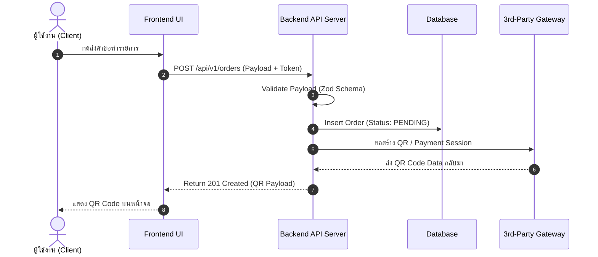

# RFC & Technical Architecture: [RFC-XXX] [ชื่อสถาปัตยกรรมทางเทคนิค]

* **RFC ID**: `RFC-XXX`
* **Feature Reference**: [`FEAT-XXX.md`](file:///home/jakee/Projects/IMPS-Pipeline/.specs/features/FEAT-XXX.md)
* **Status**: `PROPOSED` | `UNDER_REVIEW` | `APPROVED (Gate 2 Passed)` | `SUPERSEDED`
* **Author / Dev Owner**: [ชื่อ Developer / AI Agent]
* **Architecture Reviewer (Gate 2)**: [ชื่อ Tech Lead / Architect]
* **Created Date**: [YYYY-MM-DD]

---

## 1. 🏗️ Architecture & High-Level Design

### System Overview
[อธิบายว่าฟีเจอร์นี้จะถูกประกอบเข้ากับระบบปัจจุบันอย่างไร มี Component ใดบ้างที่เกี่ยวข้อง]



---

## 2. 🗄️ Database Schema & Data Modeling

### 2.1 Table Changes / New Tables
```sql
-- Migration: 20260820_create_orders_table.sql

CREATE TABLE orders (
    id UUID PRIMARY KEY DEFAULT gen_random_uuid(),
    user_id UUID NOT NULL REFERENCES users(id) ON DELETE CASCADE,
    total_amount DECIMAL(12, 2) NOT NULL CHECK (total_amount > 0),
    status VARCHAR(30) NOT NULL DEFAULT 'PENDING',
    payment_method VARCHAR(50) NOT NULL,
    created_at TIMESTAMP WITH TIME ZONE DEFAULT NOW(),
    updated_at TIMESTAMP WITH TIME ZONE DEFAULT NOW()
);

-- Indices for performance
CREATE INDEX idx_orders_user_id ON orders(user_id);
CREATE INDEX idx_orders_status ON orders(status);
```

### 2.2 Migration & Rollback Strategy
* **Up Script**: รัน `npm run db:migrate` เพื่อสร้างตารางและดัชนี
* **Down / Rollback Script**: `DROP TABLE IF EXISTS orders CASCADE;`

---

## 3. 🌐 API Contracts & Endpoints

### 3.1 `POST /api/v1/orders`
* **Authentication**: Required (`Bearer JWT`)
* **Request Body (JSON)**:
```json
{
  "cart_items": [
    { "product_id": "prod_123", "quantity": 2 }
  ],
  "payment_method": "PROMPTPAY_QR"
}
```

* **Validation Rules (Zod / Pydantic)**:
  * `cart_items`: Array of items, min length 1, max length 50
  * `quantity`: Integer, min 1, max 99
  * `payment_method`: Enum `['PROMPTPAY_QR', 'CREDIT_CARD']`

* **Success Response (201 Created)**:
```json
{
  "success": true,
  "data": {
    "order_id": "ord_987654321",
    "total_amount": 500.00,
    "status": "PENDING",
    "qr_data": "000201010212..."
  }
}
```

* **Error Responses**:
  * `400 Bad Request`: Payload validation failed
  * `401 Unauthorized`: Token missing or expired
  * `422 Unprocessable Entity`: Product out of stock

---

## 4. 🔒 Security & Performance Considerations

1. **Idempotency**: มีการใช้ `Idempotency-Key` Header ใน Request เพื่อป้องกันการกดย้ำ (Double Submit)
2. **Rate Limiting**: จำกัดคำขอสร้างออเดอร์ไม่เกิน 5 ครั้งต่อนาทีต่อ User
3. **Audit Logging**: บันทึก Log ทุกครั้งที่มีการเปลี่ยน State ของออเดอร์ลง Audit Table

---

## 5. 🧪 Test Strategy & Verification Plan

| ระดับการทดสอบ (Test Type) | ขอบเขตการทดสอบ (Scope) | เครื่องมือ (Tool) |
| :--- | :--- | :--- |
| **Unit Tests** | Schema Validation, การคำนวณยอดเงินรวม, State Machine Transitions | Vitest / Jest |
| **Integration Tests** | DB Query, API Endpoint Response, 3rd-party Mocking | Supertest + Vitest |
| **Edge-case Tests** | Concurrency Test (สั่งซื้อสินค้าชิ้นสุดท้ายพร้อมกัน 2 คน) | Test script |

---

## 🚦 Gate 2: Architecture Sign-off Checklist

- [ ] โครงสร้างระบบสอดคล้องกับ `AGENTS.md`
- [ ] Database Schema มี Index และ Migration Rollback script ครบถ้วน
- [ ] API Contract มี Schema Validation รัดกุม และระบุ Error Codes ชัดเจน
- [ ] แผนการทดสอบครอบคลุมทุก Acceptance Criteria ใน `FEAT-XXX.md`
- [ ] ไม่มีช่องโหว่ด้านความปลอดภัยที่เห็นได้ชัด (OWASP Top 10)
- [ ] **Tech Lead Signature**: ____________________ (Date: __________)
