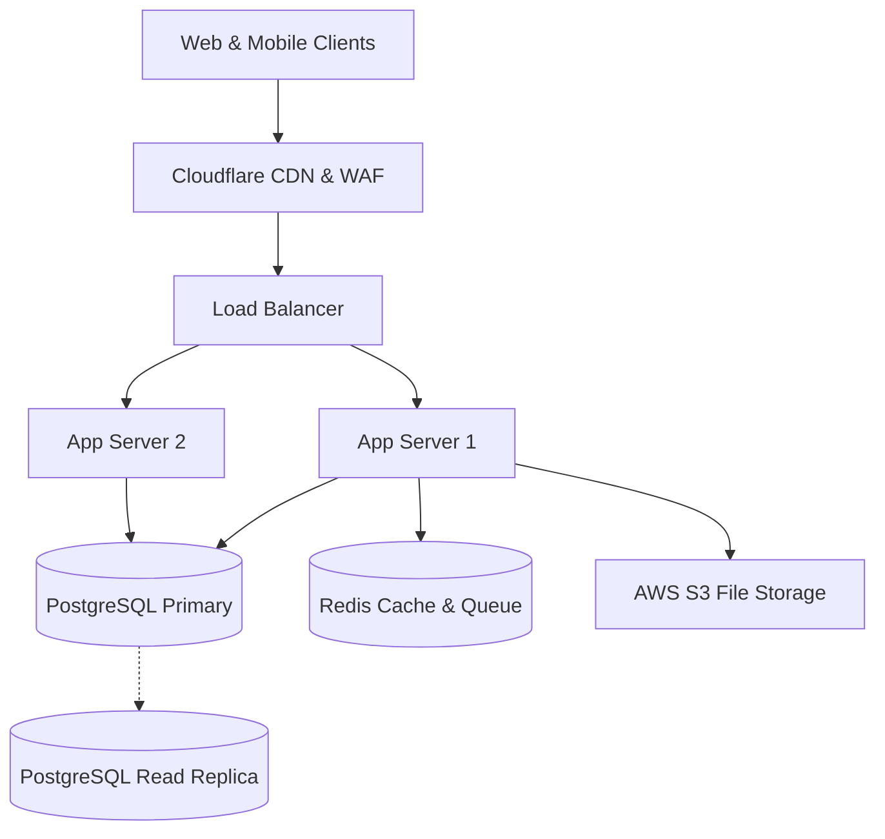

# Technical Handover & System Runbook: [Project Name]

* **Project Name**: [ชื่อโปรเจกต์]
* **Release Version**: `v1.0.0`
* **Release Date**: [YYYY-MM-DD]
* **Prepared By**: [Handover Generator Agent / Tech Lead]
* **Client Handover Recipient**: [ชื่อทีม IT / Tech Lead ฝั่งลูกค้า]

---

## 1. 🏗️ System Architecture & Infrastructure

### 1.1 High-Level Architecture
[อธิบายภาพรวมของระบบและแสดง Architecture Diagram]



### 1.2 Tech Stack Summary
* **Frontend**: Next.js 14, Tailwind CSS, TypeScript
* **Backend API**: Node.js / Express or NestJS, TypeScript
* **Database**: PostgreSQL 16
* **Cache / Queue**: Redis 7
* **Hosting / Cloud**: AWS ECS (Fargate) / Vercel / Render

---

## 2. 🗄️ Database Schemas & Data Dictionary

| ตาราง (Table Name) | คำอธิบาย (Description) | Primary Key | Foreign Keys / Dependencies |
| :--- | :--- | :--- | :--- |
| `users` | ข้อมูลบัญชีผู้ใช้งานและบทบาท (RBAC) | `id (UUID)` | - |
| `orders` | รายการสั่งซื้อและสถานะการชำระเงิน | `id (UUID)` | `user_id ➔ users(id)` |
| `payments` | ประวัติการตัดเงินและ Transaction Log | `id (UUID)` | `order_id ➔ orders(id)` |

---

## 3. 🌐 API Endpoints Catalog

| Method | Endpoint | สิทธิ์ (Auth) | คำอธิบาย |
| :--- | :--- | :---: | :--- |
| `POST` | `/api/v1/auth/login` | Public | เข้าสู่ระบบและรับ JWT Token |
| `GET` | `/api/v1/orders` | Member | ดูรายการสั่งซื้อของผู้ใช้ปัจจุบัน |
| `POST` | `/api/v1/orders` | Member | สร้างคำสั่งซื้อใหม่ |
| `POST` | `/api/v1/webhooks/payment` | Webhook Secret | รับ Notification จาก Payment Gateway |

---

## 4. 📖 Operations Runbook (คู่มือดูแลและแก้ปัญหาระบบ)

### 4.1 How to Start / Deploy Service
```bash
# 1. รัน Database Migration
npm run db:migrate

# 2. Start Application ในโหมด Production
npm run start
```

### 4.2 Health Check & Monitoring
* **Health Check URL**: `https://api.yourdomain.com/healthz`
* **Log Aggregation**: เข้าดู Application Logs ผ่าน CloudWatch / Datadog / Papertrail
* **Error Tracking**: เข้าดู Exceptions & Crash reports ผ่าน Sentry Dashboard

### 4.3 Backup & Disaster Recovery (DR)
* **Database Automated Backup**: รันทุกวันเวลา 02:00 น. (UTC) เก็บย้อนหลัง 30 วัน
* **Manual Snapshot**:
  ```bash
  pg_dump -U postgres -h [db_host] -d [db_name] -F c -b -v -f "backup_$(date +%Y%m%d).dump"
  ```
* **Rollback Procedure**:
  * **Cloud Track**: สลับ Traffic บน Load Balancer กลับ Task Definition เวอร์ชันเดิม
  * **On-Prem Track**: รัน `docker compose -f docker-compose.prod.yml down` แล้วชี้กลับไปที่ Image Archive เวอร์ชันก่อนหน้า

### 4.4 🏢 On-Premise / Air-Gapped Deployment Guide (กรณีส่งมอบ On-Prem)
* **Hardware & OS Requirements**:
  * OS: Ubuntu 22.04 LTS หรือ RHEL 9 (64-bit)
  * CPU: 4 vCPU ขั้นต่ำ | RAM: 16 GB ขั้นต่ำ | Disk: 100 GB SSD (NVMe แนะนำ)
  * Open Ports: `80/tcp` (HTTP), `443/tcp` (HTTPS), `5432/tcp` (DB Internal)
* **Offline Image Verification & Load**:
  ```bash
  # 1. ตรวจสอบความถูกต้องของ Checksum
  sha256sum -c my-app-v1.0.0.tar.gz.sha256

  # 2. นำเข้า Docker Images เข้าสู่ Local Registry
  docker load < my-app-v1.0.0.tar.gz

  # 3. รัน Service ผ่าน Docker Compose
  docker compose -f docker-compose.prod.yml up -d
  ```

---

## 5. 🔑 Credentials & Acceptance Sign-off

### 5.1 Access & Account Transfer
* **Cloud / Repository Access**: โอนสิทธิ์ Root / Organization Admin ให้แก่ทีมลูกค้าแล้ว
* **Third-Party Services**: โอนกรรมสิทธิ์ SendGrid, Payment Gateway, Sentry ให้เรียบร้อย

### 5.2 Final Go-Live Sign-off
* **ตัวแทนฝั่งลูกค้า (Client Executive / CISO Sign-off)**:
  * ลายมือชื่อ: _____________________________
  * ตำแหน่ง: _____________________________
  * วันที่: _____________________________

* **ตัวแทนฝั่ง Software House (Tech Lead / CTO Sign-off)**:
  * ลายมือชื่อ: _____________________________
  * วันที่: _____________________________
