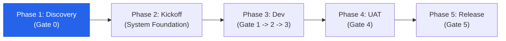

# 🚀 [Project Name] (Client Project Delivery)

> **Spec-Driven, AI-Native Project Workspace**  
> บริหารจัดการความต้องการและส่งมอบงานด้วยกระบวนการ **5-Phase & 5-Gate Governance** โดยใช้ `.specs/` เป็น Single Source of Truth (SSOT)

---

## 📌 ข้อมูลโครงการ (Project Quick Facts)

| รายการ | รายละเอียด |
| :--- | :--- |
| **ลูกค้า / Client** | [ชื่อลูกค้า / หน่วยงาน] |
| **Project Manager (PM)** | [ชื่อ PM] |
| **Tech Lead / Architect** | [ชื่อ Tech Lead] |
| **สถานะปัจจุบัน (Current Phase)** | `Phase 1: Discovery & Scope Hardening` |
| **Sign-off Gate ล่าสุด** | `Gate 0: Contract Hardening (In Progress)` |
| **Figma / Design File** | [Link Figma] |
| **SOW / Contract Document** | [Link SOW / Google Drive] |

---

## 🚦 Phase & Sign-off Gate Status



- [ ] **Gate 0: Scope Hardening Sign-off** (PM, Tech Lead, Client)
- [ ] **Gate 1: Feature DoR Sign-off** (PM & Tech Lead)
- [ ] **Gate 2: Technical RFC Sign-off** (Tech Lead)
- [ ] **Gate 3: Feature DoD Sign-off** (Dev, QA, Automated CI)
- [ ] **Gate 4: Client UAT Sign-off** (Client & PM)
- [ ] **Gate 5: Production Go-Live Sign-off** (Client, Lead, PM)

---

## 📂 โครงสร้างไดเรกทอรี (Workspace Layout)

```text
.
├── .specs/                     # 📂 Single Source of Truth
│   ├── features/               # Feature Specs (FEAT-XXX.md)
│   ├── rfcs/                   # Architecture Designs (RFC-XXX.md)
│   ├── amendments/             # Signed-off Change Requests (CR-XXX.md)
│   └── writeups/               # Handover & Post-mortem docs
├── .github/                    # 🤖 Issue/PR templates & Workflows
├── AGENTS.md                   # 📜 กฎสถาปัตยกรรม & AI Guardrails
├── tokens.json                 # 🎨 Design Tokens จาก Figma
└── apps/                       # 💻 ซอร์สโค้ดโปรเจกต์ (ติดตั้งใน Phase 2)
```

---

## 🚀 Quick Start Guide

### สำหรับ PM / BA (Phase 1: Discovery)
1. สร้าง Feature Spec ใหม่จาก [`.specs/features/FEAT-template.md`](.specs/features/FEAT-template.md) และตั้งชื่อเป็น `FEAT-001-[feature-name].md`
2. เขียน User Story, Given-When-Then Acceptance Criteria, และระบุ Out-of-Scope ให้ครบถ้วน
3. เมื่อตรวจสอบครบตาม DoR Checklist ให้ทำ Gate 1 Sign-off

### สำหรับ Developers / Tech Lead (Phase 2: Kickoff & Scaffolding)
เมื่อผ่าน Gate 0 ให้ติดตั้ง Application Stack ตามที่ตกลงไว้ใน SOW:

```bash
# ตัวอย่างการติดตั้ง Stack ของ importstar:

# 1. ติดตั้ง Frontend (SvelteKit)
npx degit importstar/create-sveltekitten apps/web

# 2. ติดตั้ง Backend (FastAPI + SQLModel หรือ Beanie)
git clone https://github.com/importstar/fastapi-sqlmodel-simplified apps/api
# หรือ
git clone https://github.com/importstar/fastapi-beanie-simplified apps/api

# ลบ .git ออกจาก subfolder
rm -rf apps/api/.git

# 3. อัปเดต Tech Stack ใน AGENTS.md ให้ตรงกับโค้ดจริง
```

### สำหรับผู้ใช้ Claude Code (ทุกคนในทีม)
1. เปิดโปรเจกต์ด้วย `claude` แล้วกด Trust folder → Claude Code จะถามให้ติดตั้ง Plugin **pstack** (จาก `cursor/plugins`) ให้กดยอมรับ
2. Model ของ pstack ตั้งไว้แล้วใน `.claude/rules/pstack-models.md` (ใช้ร่วมกันทั้งทีม) ไม่ต้องรัน `/pstack:setup-pstack` และอย่าสร้าง `~/.claude/rules/pstack-models.md` ซ้อน
3. `CLAUDE.md` เป็น symlink ไปที่ `AGENTS.md` ให้แก้กฎที่ `AGENTS.md` เท่านั้น
4. ใช้เครื่องมือตาม Gate (รายละเอียดใน `AGENTS.md` หมวด 5):

| Gate | เครื่องมือ |
| :--- | :--- |
| 0–1 (Scope, FEAT) | BMAD: `bmad-prd`, `bmad-spec`, `bmad-ux` … และ subagent `spec-reviewer` |
| 2 (RFC) | `/pstack:architect` |
| 3 (Implement, Review) | `/pstack:poteto-mode implement .specs/rfcs/RFC-XXX.md` → `/pstack:interrogate` |

> Skill ของ pstack ไม่ถูกเรียกอัตโนมัติ ต้องพิมพ์ `/pstack:<skill>` เอง

---

## 🛡️ Git & PR Conventions

1. ทุก Feature Branch ต้องมีชื่อในรูปแบบ: `feat/FEAT-XXX-short-name`
2. ทุก Bugfix Branch ต้องมีชื่อในรูปแบบ: `fix/BUG-XXX-short-name`
3. ทุก Pull Request ต้องแนบ Checklist ตาม [Pull Request Template](.github/pull_request_template.md)
